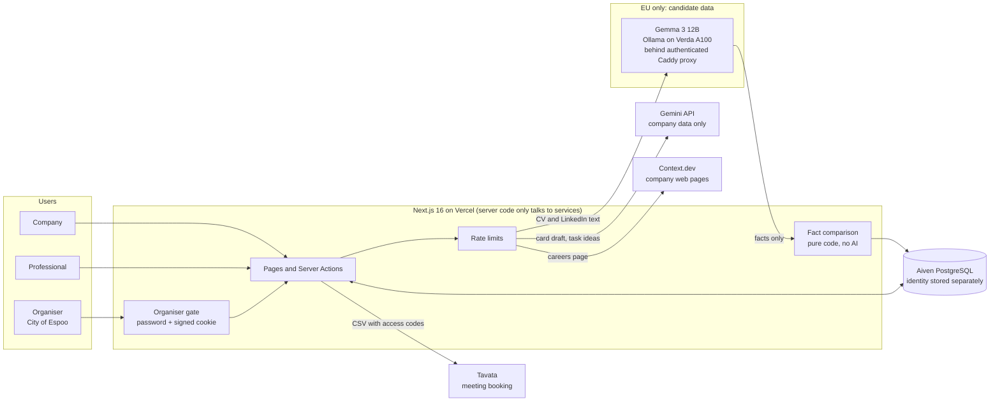
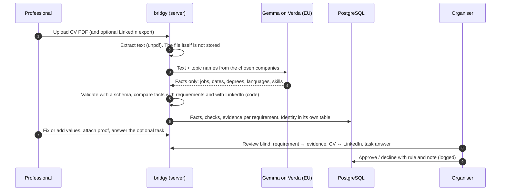
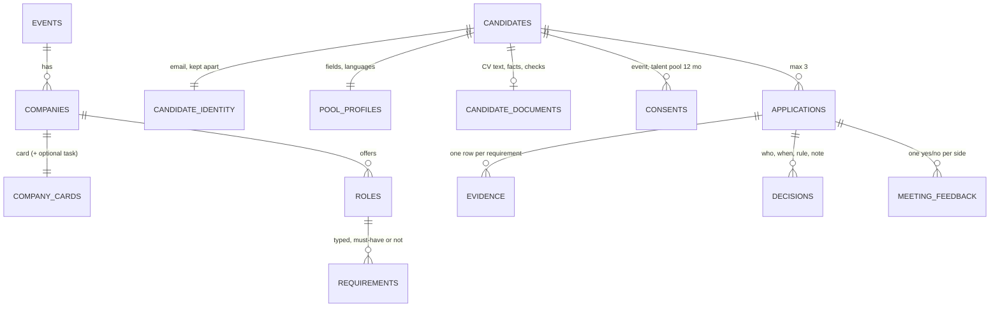

<p align="center">
  <picture>
    <source media="(prefers-color-scheme: dark)" srcset="public/brand/bridgy-logo-on-dark.png">
    
  </picture>
</p>

<p align="center"><b>Fair, fast selection for the 1:1 meetings at recruitment events.</b><br>
Built at Junction 2026 for the City of Espoo challenge “Rethinking Recruitment”.</p>

<p align="center">
  <!-- TODO: add the deployed demo URL -->
  <b>Live demo:</b> TODO ·
  <a href="#run-it-locally">Run it locally</a> ·
  <a href="#architecture">Architecture</a> ·
  <a href="#responsible-ai">Responsible AI</a>
</p>

> **Real event, synthetic people.** The event in the demo is real: the *Deep Tech Talent Forum*, 26–27 November 2026, organised by Espoo and partner cities. Every company, candidate, CV and LinkedIn profile in this repository is fictional.

---

## The problem

Espoo runs recruitment events where companies meet professionals in short 1:1 meetings, booked on the Tavata platform. Meeting places are limited, so the organisers have to choose who gets one. Today that choice is slow and weak:

- **Companies describe their needs late and vaguely.** Organisers cannot tell who is relevant.
- **Organisers read piles of similar, often AI-polished CVs** and still cannot see who actually did the work.
- **Meetings are often not relevant for either side**, and nobody measures whether they were.

## What bridgy does

bridgy adds one step before Tavata: a short, structured registration and a transparent selection.

| Who | What they do in bridgy | What they get |
|---|---|---|
| **Company** | Pastes anything (a job ad, two lines, a link). Answers up to 3 questions. Optionally adds a short task. | A clear card with typed requirements and must-haves, and a live count of matching people already in the talent pool. |
| **Professional** | Joins the talent pool in about a minute. After the company deadline, picks up to 3 companies, uploads a CV (and optionally a LinkedIn export). | A table that shows, requirement by requirement, where they meet it. Fill-in from the CV, proof optional, the same view the organiser will see. |
| **Organiser** (City of Espoo) | Reviews applications **blind**: facts next to each requirement, CV ↔ LinkedIn checks, batch-approves clean cases, approves the rest with a note. | A decision log, a bias check, and a CSV of approved people with their Tavata codes. |
| **Both sides, after the meeting** | Answer one question: “Want to continue the conversation?” | The organisers see how many meetings both sides wanted to continue, per company. |

**AI never decides.** Gemini drafts the company card from company data. Gemma, an open model on our own EU server, turns a CV into facts. **Code, not AI, compares** those facts with the requirements, so every flag an organiser sees can be traced back to a line in a document.

## How it answers the judging criteria

Each point is marked ✅ **working now** or ➡️ **next step**. Nothing below is a mock-up unless it says so.

### Impact and relevance (45%)
- ✅ **Organiser time per filled place.** Clean cases (all must-haves met, nothing to check) are approved in one batch. Only the cases that need a human look get one. The overview tracks *organiser minutes per filled meeting place*.
- ✅ **Better meetings, measured.** After each meeting both sides answer one yes/no question. The dashboard shows the share of meetings where **both** want to continue, per company.
- ✅ **Companies engage early.** A company gets a usable card in minutes from whatever text it has, and sees how many people in the pool already meet its must-haves. That is a reason to confirm before the deadline.
- ✅ **Built on the real process.** The real event, its fields and deadlines; output is a CSV with access codes for Tavata. bridgy does not replace Tavata.

### Innovation and user experience (35%)
- ✅ **Any input → structured card.** Paste a job ad or a link; Gemini drafts typed requirements (experience + years, has done, education, language level), and every quote it claims is checked against the source text by code.
- ✅ **Requirement-by-requirement application.** Candidates do not write cover letters. They see each requirement with the evidence found in their CV, fix what is missing and attach proof if they want.
- ✅ **Optional company task, defended live.** A company can add a 20-minute task (its own, or one of three ideas Gemini drafts from the card). The candidate applies it to their own past work, says whether an AI tool helped, and walks the company through the answer at the start of the meeting. Reliability comes from the live walk-through, not from an AI detector.
- ✅ **CV ↔ LinkedIn facts, not verdicts.** Same job, different title? Dates off by 8 months? A job only on LinkedIn? Shown as facts with the exact difference, never as a score.
- ➡️ Company sign-in by invitation code, a company page with meetings and email reminders after the event.
- ➡️ Several vacancies per company; event settings editable by organisers for any event.

### Responsible and feasible execution (20%)
- ✅ No score, rank or match percentage exists anywhere: not in the UI, not in the database.
- ✅ Candidate documents go **only** to the self-hosted open model in the EU (Gemma on Verda). Gemini only ever sees company data.
- ✅ Blind review: names and contact details live in a separate table that review screens never read. Identity is joined only in the export, after approval.
- ✅ Every decision is logged (who, when, rule, note), and approving anything but a clean case requires a written note.
- ✅ Bias check per company: share of non-Finnish speakers, people without a university degree and career changers among approved vs applicants.
- ✅ Organiser area behind a password, rate limits on every AI call, no files stored, synthetic data only.
- ✅ Runs on real services today: Next.js on Vercel, Aiven PostgreSQL, Gemini, Gemma on Verda, Context.dev.

## Try the demo

1. **Company** → *Companies* on the landing page → “Fill demo text” → *Create card* → answer the question → check must-haves (and the optional task) → *Confirm card*.
2. **Professional** → *Join the pool* → “Fill demo answers” → *Join* → “Demo: jump to after the company deadline” → choose **Nordic Photonics** → *Use sample CV* → *Use sample export* → “Fill demo answers” → *Send application*.
3. **Organiser** → `/organiser/review/nordic-photonics` → *Select clean cases* → *Approve* → open **A-07** (her CV says *Test Lead*, LinkedIn says *Test Engineer*) → write a note → *Approve with note* → see the decision log, the bias check and *Export for Tavata*.
4. Back on the candidate's status page: the Tavata code appears.
5. **After the event** → `/organiser/feedback` → answer as the candidate and as the company → the both-yes rate updates.

## Architecture



### What happens to a candidate's CV



### Data model (simplified)



## Tech tracks

| Track | How bridgy uses it | Evidence in this repo |
|---|---|---|
| **Gemini API** | Company input (text, or a page read by Context.dev) → company card with typed requirements, must-haves and up to 3 clarifying questions; three ideas for the optional task. JSON schema output, validated with zod, retried on invalid output, every quote verified against the source. Company data only. | `lib/gemini.ts`, `lib/prompts/company-card.ts`, `lib/prompts/task-suggest.ts`, `npm run eval:company` |
| **Gemma** | Open model (Gemma 3 12B) reads CVs and LinkedIn exports and returns facts only, never judgements. An open model on our own server is what lets candidate data stay in the EU and out of third-party APIs. | `lib/gemma.ts`, `lib/prompts/cv-parse.ts`, `npm run eval:cv` (11/11 checks on the demo PDFs) |
| **Verda** | Gemma runs on a Verda A100 with Ollama, behind a Caddy reverse proxy that requires a token. | `infra/verda/` |
| **Aiven** | PostgreSQL with separated identity, consents with expiry, the decision log, meeting feedback and rate-limit counters. pgvector is installed; semantic evidence search is the next step. | `db/migrations/`, `lib/db.ts`, `lib/rate-limit.ts` |
| **Context.dev** | Reads the company's careers page when the company pastes a link, so the card can quote it. Company websites only. | `lib/contextdev.ts` |
| **Entire** | Agent sessions and checkpoints for the commits in this repository. Graph and Brain are configured for agents working in the repo. | `.entire/` |

## Responsible AI

The challenge asks for no automated decisions about people and for compliance with the EU AI Act. These rules are enforced in code and listed in [`AGENTS.md`](AGENTS.md):

- **AI never scores, ranks, accepts or rejects a person.** Humans decide; AI drafts, extracts and explains.
- **Candidate data goes only to Gemma on our EU server.** Gemini receives company data only.
- **The candidate's own words are kept as written,** next to anything processed.
- **Identity is stored separately from answers;** review screens are blind.
- **Every selection decision is logged** with reviewer, time, rule and note.
- **Meeting feedback is shown only as aggregates** per company, never as a judgement of a person.
- **AI use is disclosed, not detected.** Candidates say whether an AI tool helped with a task; organisers see that statement. AI-text detectors are unreliable and unfair to non-native writers.
- **Synthetic data only.**

## Run it locally

Requirements: Node 20+, a PostgreSQL database (we use Aiven), and optionally keys for Gemini, Context.dev and a Gemma endpoint. Every AI service has a fallback, so the app also runs with only a database.

```bash
npm install
cp .env.example .env        # fill in DATABASE_URL and any keys you have
npm run db:migrate          # create the tables
npm run db:seed             # the real event + synthetic companies and people
npm run dev                 # http://localhost:3000
```

| Variable | What it is for |
|---|---|
| `DATABASE_URL`, `DATABASE_CA_CERT` | PostgreSQL connection and CA certificate |
| `GEMINI_API_KEY`, `GEMINI_MODEL` | Company card drafting and task ideas |
| `GEMMA_BASE_URL`, `GEMMA_MODEL`, `GEMMA_API_KEY` | OpenAI-compatible Gemma endpoint (Ollama on Verda) |
| `CONTEXT_DEV_API_KEY` | Reading company web pages |
| `ORGANISER_PASSWORD` | Organiser sign-in. Unset: open in development, locked in production |
| `DEMO_MODE` | `1` enables the demo reset buttons |

Checks before every commit: `npm run lint && npm run build && npx tsc --noEmit`. Service status: `GET /api/health`.

## Repository map

```
app/                 pages: landing, company, candidate, organiser, meeting, login
components/          shells, back link, shared fact labels, UI primitives
lib/                 one wrapper per service (gemini, gemma, contextdev, esco, db), auth, rate limits
lib/matchready/      domain: event, config, facts (pure comparison code), card, candidate, organiser, feedback
lib/prompts/         every AI prompt, as named constants
db/                  migrations and synthetic seed data
scripts/             migrate, seed, evals, dev checks
infra/verda/         Gemma proxy setup
docs/                CONTEXT.md (decisions), HANDOFF.md (state and open work)
```

## Team

<!-- TODO: add team members -->
TODO

Made at Junction 2026, Helsinki. All companies and people in this project are fictional.
