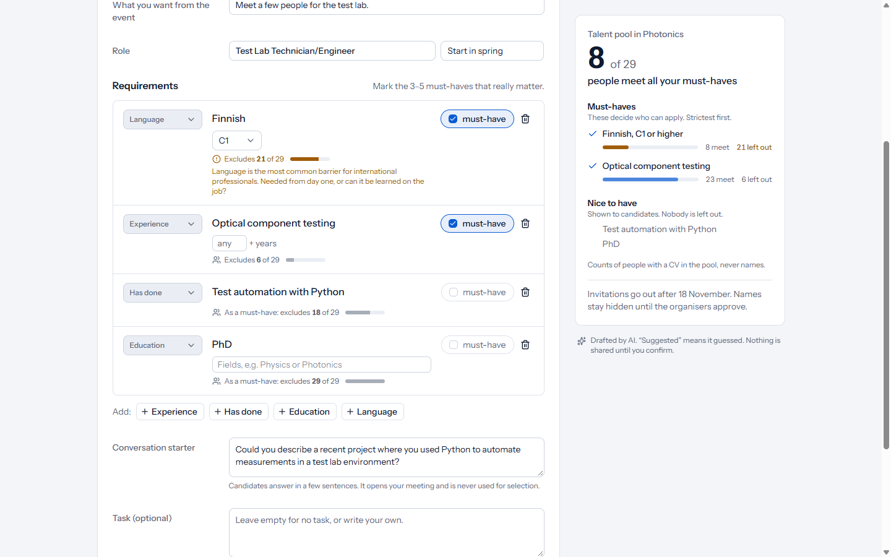
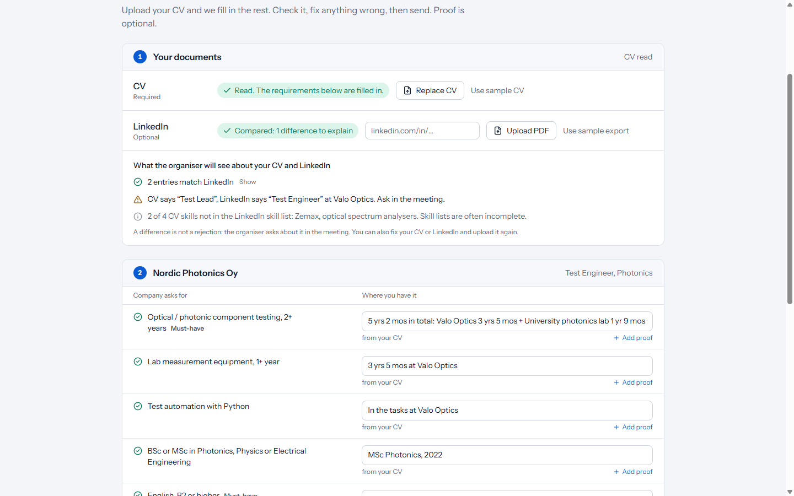
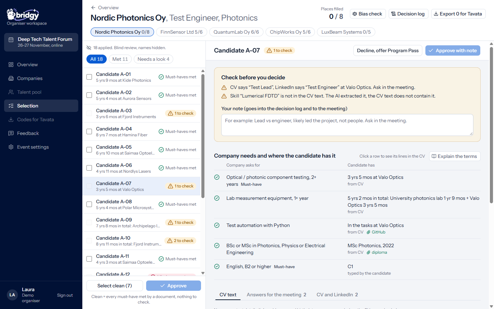
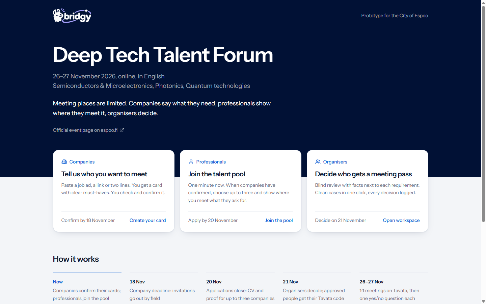
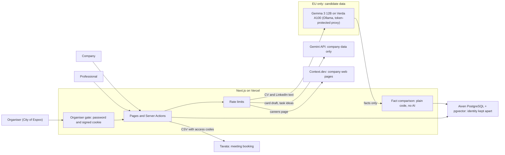
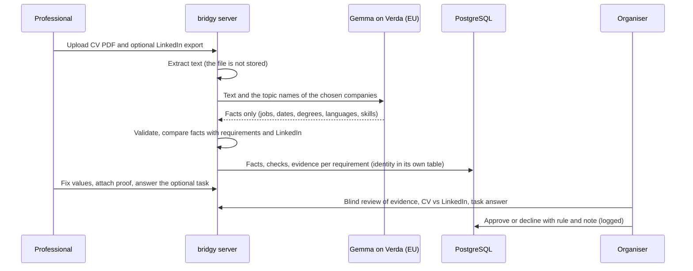
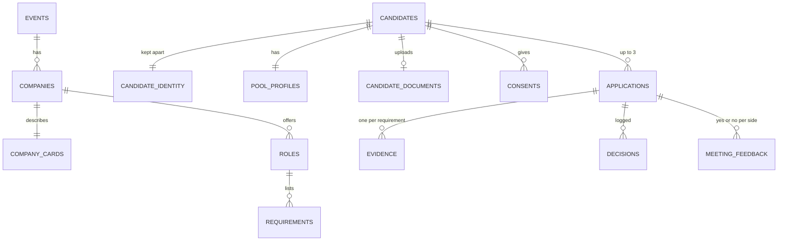

<p align="center">
  <picture>
    <source media="(prefers-color-scheme: dark)" srcset="public/brand/bridgy-logo-on-dark.png">
    
  </picture>
</p>

<p align="center"><b>Fair, fast selection for the 1:1 meetings at recruitment events.</b><br>
Built at Junction 2026 for the City of Espoo challenge “Rethinking Recruitment”.</p>

<p align="center">
  
  
  <a href="https://junction-2026-lafa.vercel.app"></a>
</p>

<p align="center">
  <b>Tech challenges</b><br>
  
  
  
  
  
  
</p>

<p align="center">
  <b>Stack</b><br>
  
  
  
  
  
  
</p>

<p align="center">
  <a href="#screenshots">Screenshots</a> ·
  <a href="#tech-challenges-and-stack">Tech challenges and stack</a> ·
  <a href="#responsible-ai">Responsible AI</a> ·
  <a href="#run-it-locally">Run it locally</a>
</p>

> **Real event, synthetic people.** The event in the demo is real: the *Deep Tech Talent Forum*, 26–27 November 2026, organised by Espoo and partner cities. Every company, candidate, CV and LinkedIn profile here is fictional.

! Demo was live during Junction 2026 and is now offline; see screenshots below

### In 30 seconds

- **What:** one step before Tavata that decides who gets the limited 1:1 meeting places at Espoo's recruitment events. Companies describe their need, professionals show where they meet it, organisers select in one blind table.
- **Our position:** AI structures, people decide. Nothing in bridgy scores, ranks or rejects a person. AI turns messy text into facts; plain code compares the facts with the requirements; every decision is made and logged by a human.
- **Three things to look at:** the *barrier check* (a company sees how many people each must-have leaves out, before anyone applies), *AI checked by code* (anything the model extracted that the CV does not contain is shown to the organiser), and *one-click approval of clean cases* so organisers spend time only where a human look is needed.
- **Privacy by architecture:** CVs are read only by open models on our own GPU server in the EU. Gemini only ever sees company data.
- **Try it:** [live demo](https://junction-2026-lafa.vercel.app), about 5 minutes, all three roles: see [Try the demo](#try-the-demo).

---

## The problem

Espoo runs recruitment events where companies meet professionals in short 1:1 meetings, booked on the Tavata platform. Places are limited, so organisers must choose who gets one, and today that choice is slow:

- Companies describe what they need late and vaguely.
- Organisers read piles of similar, often AI-polished CVs and still can't see who actually did the work.
- Many meetings turn out irrelevant for one side, and nobody measures it.

## What bridgy does

bridgy adds one step before Tavata: a short, structured registration and a transparent selection.

| Who | Does | Gets |
|---|---|---|
| **Company** | Pastes anything: a job ad, two lines, a link. Answers up to 3 questions, optionally adds a short task. | A card with typed requirements and must-haves, and a live count of matching people already in the talent pool. |
| **Professional** | Joins the talent pool in about a minute. Later picks up to 3 companies and uploads a CV (LinkedIn export optional). | A table showing, requirement by requirement, where they meet it. Pre-filled from the CV, the same view the organiser gets. |
| **Organiser** (City of Espoo) | Reviews blind: facts next to each requirement, CV ↔ LinkedIn checks. Approves clean cases in one batch, the rest with a note. | A decision log, a bias check and a CSV with Tavata codes. |
| **Both, after the meeting** | Answer one question: “Want to continue the conversation?” | The share of meetings where both said yes, per company. |

**AI never decides.** Gemini drafts the company card from company data. Gemma, an open model on our own EU server, turns a CV into facts. **Plain code compares** those facts with the requirements, so every flag an organiser sees traces back to a line in a document.

## Screenshots

| Company card with the barrier check | Candidate application |
|---|---|
|  |  |
| **Organiser review** | **Landing page** |
|  |  |

## How it meets the judging criteria

**Impact and relevance (45%)**
- Clean cases are approved in one batch, so organisers spend their time only where a human look is needed. We track *organiser minutes per filled place*.
- After each meeting both sides answer one yes/no question; we track *the share of meetings both want to continue*.
- It fits the real process: the real event, its fields and deadlines, and a CSV for Tavata. bridgy does not replace Tavata.

**Innovation and user experience (35%)**
- Any text or link becomes a structured card in minutes; quotes the AI claims are checked against the source by code.
- No cover letters: candidates confirm evidence per requirement and attach proof if they want.
- An optional company task, answered from the candidate's own past work and walked through at the start of the meeting. Candidates say whether an AI tool helped.
- CV ↔ LinkedIn differences are shown as facts (“CV says Test Lead, LinkedIn says Test Engineer”), never as a score.
- Every fact traces back to the CV: click a requirement and the lines it comes from light up in the CV text. Lines related by meaning (EmbeddingGemma + pgvector) are marked separately, and candidates get the same hint: “Your CV mentions … Use it?”
- **Barrier check:** while a company marks must-haves it sees how many people in the pool each one leaves out, and a language requirement that contradicts its own text is flagged. Bias is stopped where it starts, in the job description, and nobody is scored.

**Responsible and feasible execution (20%)**
- No score, rank or match percentage exists anywhere, in the UI or the database.
- Candidate documents go only to the self-hosted open model in the EU. Gemini only sees company data.
- Blind review, a logged decision for every approval, a bias check per company.
- The AI is checked by code against the document: anything it extracted that the CV text does not contain is listed for the organiser. Personal details are cut out of the CV text on upload, before any organiser can see it.
- Running on real services: Vercel, Aiven, Gemini, Gemma on Verda, Context.dev.

**Also built**
- Companies sign in with an invitation code and get their own page: card, selection status and their meetings. After the event both sides get an e-mail reminder and answer “want to continue?”; if both say yes, the organisers connect them.
- Organisers add companies and hand out invitation codes on their own Companies page, so the platform is not tied to the demo data. A code is shown once and only its fingerprint is stored.
- Organisers set the event itself in Event settings: name, dates, fields and types of work. Every page reads these values, so the same platform runs the next event.

**Next steps:** several vacancies per company; several events side by side; organiser accounts instead of one shared password.

## Try the demo

About 5 minutes on the [live demo](https://junction-2026-lafa.vercel.app). Three roles, each with its own entry on the landing page; the demo buttons (“Fill demo text”, “Use sample CV”) fill in synthetic data so you never type.

1. **Company:** *Companies* on the landing page → sign in with the demo code `KUURA-2026` → “Fill demo text” → *Create card* → answer the question → mark must-haves and watch the panel on the right: how many people meet all of them, and how many each one leaves out (try adding “Finnish, B1”) → *Confirm card*.
2. **Professional:** *Join the pool* → “Fill demo answers” → *Join talent pool* → “Demo: jump to after the company deadline” → choose **Nordic Photonics**, tick “still available” → *Use sample CV* → *Use sample export* → “Fill demo answers” → *Send application*.
3. **Organiser:** *Open workspace* → sign in (the organiser password is in our Junction submission) → *Selection* (Nordic Photonics) → *Select clean* → *Approve*: seven people who meet every must-have, in one click. Then **A-07** opens with *Check before you decide*: her CV says *Test Lead*, LinkedIn says *Test Engineer*, and the AI extracted a skill the CV does not contain. Click a requirement to see its lines in the CV (dashed lines are related by meaning, found by EmbeddingGemma), press *Explain the terms* for a plain-language glossary, write a note → *Approve with note*. *Bias check*, *Decision log* and *Export for Tavata* are in the header.
4. Back on the candidate's status page: once the organiser approves them, the Tavata code appears.
5. **After the event:** sign in as a company with `QUANTUMLAB-2026` → *Your meetings* → answer Yes. Then open `/candidate/cand.001` (candidate A-01) → answer Yes → both see “You both want to continue”. Organisers can send the reminder e-mails from `/organiser/feedback` → *Remind both sides*.
6. **Event settings:** `/organiser/settings` → change the event name or add a type of work → *Save settings* → the landing page, headers and talent-pool form show it.

The live demo is shared by every visitor. If someone got there first, press *Start over (demo)* on the company card, or *Reset demo* in the organiser's *Decision log* panel, to put that step back to the start.

Running locally? The company step reads its careers page through Context.dev, which cannot reach `localhost`: paste the job ad text instead, or use the live demo. `npm run db:seed` resets everything, including the settings.

## Tech challenges and stack

### Which data goes where

| Data | Goes to | Never goes to |
|---|---|---|
| Company text, careers page, requirements | Gemini API, Context.dev | — |
| CVs, LinkedIn exports, candidate answers | Gemma 3 12B and EmbeddingGemma on our own Verda server (EU) | Gemini, Context.dev or any other external API |
| Everything that is stored | Aiven PostgreSQL (EU), identity in its own table | — |

### How each tool is used

| Tool | What it does in bridgy | Why this tool | Code |
|---|---|---|---|
| **Gemini API** (`gemini-3.1-flash-lite`) | Turns a company's text or careers page into a card: typed requirements, must-haves and at most three clarifying questions, only where the answer changes the card. Also drafts three ideas for the optional task and the organisers' glossary (*Explain the terms*). | Strong structured output on messy company text. JSON schema, validated with zod, retried on invalid output; every quote it claims is checked against the source by code. | `lib/gemini.ts`, `lib/prompts/`, `npm run eval:company` |
| **Gemma** | Gemma 3 12B reads CVs and LinkedIn exports and returns facts only: jobs, dates, degrees, languages, skills. EmbeddingGemma turns de-identified CV lines and requirements into vectors for meaning search. | An open model we run ourselves is the only way candidate data stays in the EU and out of third-party APIs. | `lib/gemma.ts`, `lib/prompts/cv-parse.ts`, `lib/matchready/semantic.ts`, `npm run eval:cv` (11/11) |
| **Verda** | Hosts both models on an A100 with Ollama, behind a Caddy proxy that requires a token. | EU GPU we control: no candidate document leaves our infrastructure. | `infra/verda/` |
| **Aiven** | PostgreSQL holds the separated identity table, consents with expiry, the decision log, meeting feedback and rate limits. **pgvector** finds the CV lines nearest to a requirement in SQL, shown as “related by meaning, not checked”. | Managed Postgres in the EU with pgvector in the same database, so vectors sit next to the data they describe and nothing extra to run. | `db/migrations/`, `lib/db.ts`, `lib/matchready/semantic.ts` |
| **Context.dev** | Reads the careers page a company links to, so its card can quote the real job ad. | Clean markdown from any company website in one call. Company websites only. | `lib/contextdev.ts` |
| **Entire** | Session hooks on every commit, Graph and Brain for the coding agents that built this repository. | Keeps the agent's sessions linked to commits, and gives it the recorded decisions and the code map, so it does not re-read the repository or forget a rule. | `.entire/` |

### Each technology in detail

**Gemini API: company data only** (`lib/gemini.ts`, prompts in `lib/prompts/`)
- **Card draft** (`company-card.ts`): the company's text, plus its careers page if it links one, becomes a card with a summary, tasks and typed requirements (years of experience, language with CEFR level, education, has done). Each requirement is marked as found in the text or guessed. Gemini asks at most 3 clarifying questions, and only where the answer changes the card (“The ad mentions a PhD. Is it required?”).
- **Quotes checked by code:** if Gemini says a requirement comes from the text, code looks for its quote in the source. If the quote is not there, the requirement is labelled “suggested by AI, check it” instead of “from your text”.
- **Task ideas** (`task-suggest.ts`): three ideas for an optional 20-minute task that a candidate answers from their own past work.
- **Organiser glossary** (`glossary.ts`): *Explain the terms* turns each requirement into plain words and says what it looks like in a CV, so an organiser who is not a photonics expert can read the evidence. Cached per requirement wording, so the same term is not paid for twice.
- Every response must match a JSON schema and pass zod, or the call is retried. Calls are rate-limited (6 drafts per client per 10 minutes, 300 a day). When Gemini is down, the company gets a basic draft to edit by hand.

**Gemma 3 12B: candidate documents** (`lib/gemma.ts`, `lib/prompts/cv-parse.ts`, `lib/matchready/candidate-service.ts`)
- **What it reads:** the text of an uploaded CV PDF and an optional LinkedIn PDF export, up to 30,000 characters. The text is pulled out of the PDF on our server with unpdf, and the file itself is not stored.
- **What it returns:** facts only, as JSON: jobs with employer, title and dates; degrees; languages; skills, each with the line it was found on. There is no field for a score or an opinion.
- **What code does with it:** it computes durations (“3 yrs 5 mos at Valo Optics”), compares each fact with each requirement, and compares CV with LinkedIn (titles, dates within 3 months, graduation year within 1 year). A skill that the CV text does not contain is listed for the organiser as “not in the CV text”.
- **What organisers see:** a de-identified copy of the CV (name, e-mail, phone, links, address, date of birth and nationality are cut out on upload by plain code, `lib/matchready/redact.ts`; each cut leaves a visible marker), with the lines behind each fact highlighted.
- Quality is checked with `npm run eval:cv`: 11 synthetic CVs and LinkedIn exports, 11/11 pass. When Gemma is down, the candidate fills in the requirements by hand. A failed Gemma call never falls back to another model.

**EmbeddingGemma: meaning search** (`lib/gemma.ts` `embed()`, `lib/matchready/semantic.ts`)
- When a CV is uploaded, each line of the **de-identified** CV becomes a 768-number vector. Each requirement is embedded once and re-embedded when its wording changes.
- It uses the model's task prefixes (`task: search result | query:` for the requirement, `title: none | text:` for the CV line), which makes search more accurate.
- For each requirement, up to 2 CV lines with cosine similarity ≥ 0.35 are shown with a dashed outline as “related by meaning, not checked”. The candidate sees the same hint: “Your CV mentions … Use it?”
- No status, filter or order of candidates is based on these vectors.

**Verda: our own GPU in the EU** (`infra/verda/`)
- One A100 40 GB server runs Ollama with `gemma3:12b` and `embeddinggemma`. `OLLAMA_KEEP_ALIVE=2h` keeps both models loaded, so no request waits for a reload.
- Ollama has no authentication, so Caddy sits in front of it: HTTPS, and every request must carry a secret token. The app talks to it through the OpenAI-compatible API (`openai` npm package with our own base URL); nothing is sent to OpenAI.
- `setup-gemma-proxy.sh` sets up the whole server in one run.

**Aiven: PostgreSQL + pgvector in the EU** (`lib/db.ts`, `db/migrations/`)
- **Separated identity:** names and e-mails live in `candidate_identity`; reviewers work with blind codes such as A-07.
- **Consents with an expiry date**, the **decision log** (who, when, rule, note, batch or single), review sessions for the *organiser minutes per filled place* metric, and meeting feedback stored only as yes/no per side and shown as totals per company.
- **Rate limits** are stored in the same database: the client is a keyed hash of the IP address, and the address itself is never stored.
- **pgvector** stores the vectors in `cv_line_vectors` and `requirement_vectors`. One SQL query (`<=>` with a LATERAL join) finds the nearest lines. `ON DELETE CASCADE` removes a candidate's vectors together with the candidate.
- TLS with Aiven's CA certificate (`sslmode=require`). Migrations run with `npm run db:migrate`; `npm run db:seed` loads the real event and synthetic people.

**Context.dev: company web pages only** (`lib/contextdev.ts`)
- If the company's text contains a link, Context.dev returns that page as clean markdown, and up to 15,000 characters go into the Gemini prompt with the company's own words. The card can then quote the real job ad.
- Company websites only; People Search is never used. If the page cannot be read, the card is drafted from the pasted text alone.

**Entire: how we built it** (`.entire/`)
- Hooks record every Claude Code session as a checkpoint linked to its commit. **Graph** gives the agent the code it needs within a fixed context budget. **Brain** gives it the recorded decisions before it changes anything, for example “candidate data goes only to Gemma”. See [How we used Entire](#how-we-used-entire).

**The app itself**
- **Next.js 16 on Vercel:** App Router pages and Server Actions. Every external call runs in server code, and no key reaches the browser. Every organiser action checks `isOrganiser()` itself, and every company action checks that the company acts only for itself.
- **zod** validates every AI response and every form input. **Tailwind CSS 4 + shadcn/Radix** for accessible components; colour is used only for status, always with an icon and a word.
- **Resend** sends the after-the-meeting reminders; without a key, they are shown as previews.
- `GET /api/health` shows whether each service is live, stubbed or down.

### Why these choices

- **Gemma 3 12B, not 27B or a closed API.** The model only extracts facts (jobs, dates, degrees, languages, skills) into a JSON schema; it never judges anyone, so the task does not need the largest model. We picked the smallest Gemma that passes our CV eval (11/11). 12B takes about 8 GB of the A100's 40 GB, which leaves room for long CVs, EmbeddingGemma and several uploads at once, and it answers faster while the candidate waits. The 1B and 4B models are weaker at strict JSON and dates. An open model is the only option for CVs: it runs on our own server in the EU. Changing the model is one variable (`GEMMA_MODEL`), no code change.
- **Reliability comes from code, not model size.** Every AI answer is validated with zod and retried if invalid; every quote is checked against the source; every extracted fact is shown next to the CV line it came from.
- **Plain code compares facts with requirements.** A rule such as “3 years ≥ 2 years” is explainable, the same for everyone and gives the same answer every time. A model that decides who meets a requirement would make bridgy a high-risk AI system under the EU AI Act, and could answer differently on the next run.
- **Gemini Flash-Lite for company cards.** Company text is not personal data, so a cloud model is fine. The card is a structured task with a JSON schema, so the fast, low-cost model passes our company eval and the company gets its draft in seconds. Temperature is low (0.2), and the company always reviews the draft: what came from its text and what the AI suggested are labelled.
- **EmbeddingGemma + pgvector in the same Postgres.** A small multilingual embedding model on the same EU server, and vectors stored next to the CV lines they describe: deleting a candidate deletes their vectors in the same transaction. No separate vector database to keep in sync. The similarity threshold (0.35) was calibrated on our data; related lines are shown as a hint, marked “not checked”, and never counted.

### What we have not proven yet

- bridgy has not been tested with real organisers, companies or candidates; every number in the demo comes from synthetic people.
- The evals are small: 11 synthetic CVs and a set of synthetic company texts.
- The same company text can produce a slightly different draft card on each run. That is why the company confirms every requirement before the card goes live.

**Stack:** Next.js 16 (App Router, Server Actions), TypeScript strict, Tailwind CSS 4, deployed on Vercel. Every external call runs in server code, every AI call has a fallback so the app keeps working when a service is down, and every AI call reachable from a public page is rate-limited.

### How we used Entire

We built bridgy with Claude Code, tracked by **Entire**. Every session is a checkpoint linked to the commit it produced. The agent guide in [`.entire/agent-guide.md`](.entire/agent-guide.md) makes the agent use **Graph** to find code within a fixed context budget and **Brain** to recall recorded decisions before changing anything, for example the invariant that candidate data only goes to Gemma. Token use is measured per checkpoint. The checkpoints stay local: their transcripts contain personal details and this repository is public.

### Architecture



### What happens to a CV



### Data model (simplified)



## Responsible AI

The challenge rules out automated decisions about people and asks for compliance with the EU AI Act. These rules are enforced in code and written down in [`AGENTS.md`](AGENTS.md):

- **AI never scores, ranks, accepts or rejects a person.** People decide; AI drafts, extracts and explains.
- **Candidate data goes only to Gemma on our EU server.** Gemini gets company data only.
- **Candidates' own words are kept as written**, next to anything processed.
- **Identity is stored apart from answers**; review is blind until approval.
- **Every selection decision is logged** with reviewer, time, rule and note.
- **Meeting feedback is shown only as totals per company**, never as a judgement of a person.
- **AI use is declared, not detected.** AI-text detectors are unreliable and unfair to non-native writers, so candidates say whether a tool helped and organisers see that.
- **Synthetic data only.**

## Run it locally

You need Node 20+ and a PostgreSQL database (we use Aiven). Keys for Gemini, Context.dev and a Gemma endpoint are optional: every AI service has a fallback.

```bash
npm install
cp .env.example .env        # fill in DATABASE_URL and any keys you have
npm run db:migrate          # create the tables
npm run db:seed             # the real event + synthetic companies and people
npm run dev                 # http://localhost:3000
```

| Variable | Used for |
|---|---|
| `DATABASE_URL`, `DATABASE_CA_CERT` | PostgreSQL connection and CA certificate |
| `GEMINI_API_KEY`, `GEMINI_MODEL` | Company cards and task ideas |
| `GEMMA_BASE_URL`, `GEMMA_MODEL`, `GEMMA_API_KEY` | OpenAI-compatible Gemma endpoint (Ollama on Verda) |
| `GEMMA_EMBED_MODEL` | Embedding model on the same Ollama (default `embeddinggemma`; `ollama pull embeddinggemma`) |
| `CONTEXT_DEV_API_KEY` | Reading company web pages |
| `ORGANISER_PASSWORD` | Organiser sign-in. Unset: open in development, locked in production |
| `DEMO_MODE` | `1` enables the demo reset buttons |
| `SESSION_SECRET` | Signs company and organiser sessions (optional) |
| `RESEND_API_KEY`, `EMAIL_FROM`, `DEMO_EMAIL_TO` | Reminder e-mails via Resend. Without a key they are shown as previews; `DEMO_EMAIL_TO` sends every demo e-mail to one inbox |

Before every commit: `npm run lint && npm run build && npx tsc --noEmit`. Service status: `GET /api/health`.

## Repository map

```
app/              pages: landing, company, candidate, organiser, meeting, login
components/       shells, back link, shared fact labels, UI primitives
lib/              one wrapper per service, auth, rate limits
lib/matchready/   domain: event, config, facts (comparison code), card, candidate, organiser, feedback
lib/prompts/      every AI prompt as a named constant
db/               migrations and synthetic seed data
scripts/          migrate, seed, evals, dev checks
infra/verda/      Gemma proxy setup
docs/             CONTEXT.md (decisions), HANDOFF.md (state and open work)
```

## Team


Filip Fylyp, Oleksandr Lysytsia, Svitlana Meleshko, Artem Lobodiuchenko.

Made at Junction 2026, Espoo. All companies and people in this project are fictional.
