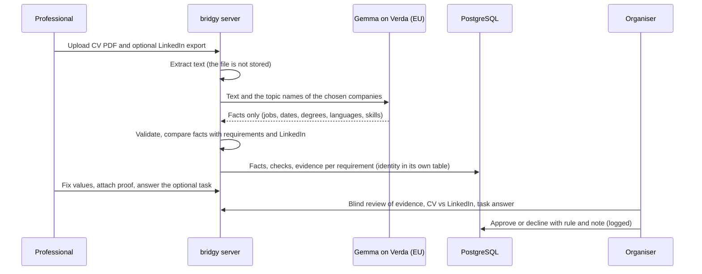
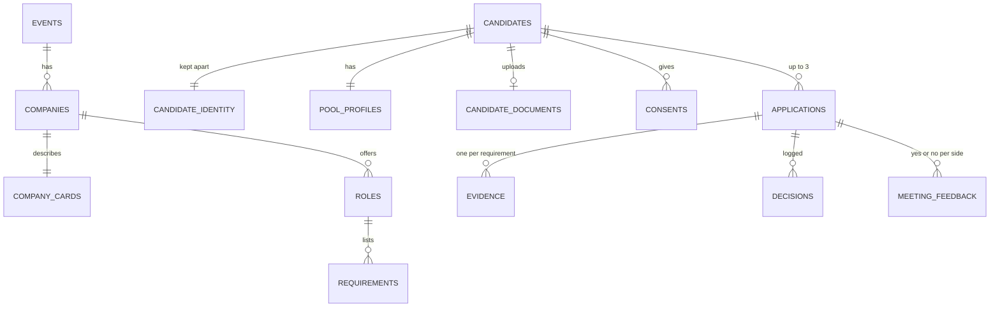

<p align="center">
  <picture>
    <source media="(prefers-color-scheme: dark)" srcset="public/brand/bridgy-logo-on-dark.png">
    
  </picture>
</p>

<p align="center"><b>Fair, fast selection for the 1:1 meetings at recruitment events.</b><br>
Built at Junction 2026 for the City of Espoo challenge “Rethinking Recruitment”.</p>

<p align="center">
  
  
  <!-- TODO: replace https://YOUR-PROJECT.vercel.app with the deployed URL -->
  <a href="https://junction-2026-lafa.vercel.app"></a>
</p>

<p align="center">
  <b>Tech challenges</b><br>
  
  
  
  
  
  
</p>

<p align="center">
  <b>Stack</b><br>
  
  
  
  
  
  
</p>

<p align="center">
  <a href="#try-the-demo">Try the demo</a> ·
  <a href="#tech-challenges-and-stack">Tech challenges and stack</a> ·
  <a href="#responsible-ai">Responsible AI</a> ·
  <a href="#run-it-locally">Run it locally</a>
</p>

> **Real event, synthetic people.** The event in the demo is real: the *Deep Tech Talent Forum*, 26–27 November 2026, organised by Espoo and partner cities. Every company, candidate, CV and LinkedIn profile here is fictional.

---

## The problem

Espoo runs recruitment events where companies meet professionals in short 1:1 meetings, booked on the Tavata platform. Places are limited, so organisers must choose who gets one, and today that choice is slow:

- Companies describe what they need late and vaguely.
- Organisers read piles of similar, often AI-polished CVs and still can't see who actually did the work.
- Many meetings turn out irrelevant for one side, and nobody measures it.

## What bridgy does

bridgy adds one step before Tavata: a short, structured registration and a transparent selection.

| Who | Does | Gets |
|---|---|---|
| **Company** | Pastes anything: a job ad, two lines, a link. Answers up to 3 questions, optionally adds a short task. | A card with typed requirements and must-haves, and a live count of matching people already in the talent pool. |
| **Professional** | Joins the talent pool in about a minute. Later picks up to 3 companies and uploads a CV (LinkedIn export optional). | A table showing, requirement by requirement, where they meet it. Pre-filled from the CV, the same view the organiser gets. |
| **Organiser** (City of Espoo) | Reviews blind: facts next to each requirement, CV ↔ LinkedIn checks. Approves clean cases in one batch, the rest with a note. | A decision log, a bias check and a CSV with Tavata codes. |
| **Both, after the meeting** | Answer one question: “Want to continue the conversation?” | The share of meetings where both said yes, per company. |

**AI never decides.** Gemini drafts the company card from company data. Gemma, an open model on our own EU server, turns a CV into facts. **Plain code compares** those facts with the requirements, so every flag an organiser sees traces back to a line in a document.

## How it meets the judging criteria

**Impact and relevance (45%)**
- Clean cases are approved in one batch, so organisers spend their time only where a human look is needed. We track *organiser minutes per filled place*.
- After each meeting both sides answer one yes/no question; we track *the share of meetings both want to continue*.
- It fits the real process: the real event, its fields and deadlines, and a CSV for Tavata. bridgy does not replace Tavata.

**Innovation and user experience (35%)**
- Any text or link becomes a structured card in minutes; quotes the AI claims are checked against the source by code.
- No cover letters: candidates confirm evidence per requirement and attach proof if they want.
- An optional company task, answered from the candidate's own past work and walked through at the start of the meeting. Candidates say whether an AI tool helped.
- CV ↔ LinkedIn differences are shown as facts (“CV says Test Lead, LinkedIn says Test Engineer”), never as a score.

**Responsible and feasible execution (20%)**
- No score, rank or match percentage exists anywhere, in the UI or the database.
- Candidate documents go only to the self-hosted open model in the EU. Gemini only sees company data.
- Blind review, a logged decision for every approval, a bias check per company.
- Running on real services: Vercel, Aiven, Gemini, Gemma on Verda, Context.dev.

- Companies sign in with an invitation code and get their own page: card, selection status and their meetings. After the event both sides get an e-mail reminder and answer “want to continue?”; if both say yes, the organisers connect them.

**Next steps:** several vacancies per company; event settings that organisers can change for any event; organiser accounts instead of one shared password.

## Try the demo

1. **Company:** *Companies* on the landing page → sign in with the demo code `KUURA-2026` → “Fill demo text” → *Create card* → answer the question → set must-haves (and an optional task) → *Confirm card*.
2. **Professional:** *Join the pool* → “Fill demo answers” → *Join talent pool* → “Demo: jump to after the company deadline” → choose **Nordic Photonics** → *Use sample CV* → *Use sample export* → “Fill demo answers” → *Send application*.
3. **Organiser:** sign in at `/login` → `/organiser/review/nordic-photonics` → *Select clean cases* → *Approve selected* → open **A-07** (her CV says *Test Lead*, LinkedIn says *Test Engineer*; she also answered the company task) → write a note → *Approve with note* → decision log, bias check, *Export for Tavata*.
4. Back on the candidate's status page, the Tavata code appears.
5. **After the event:** sign in as a company with `QUANTUMLAB-2026` → *Your meetings* → answer Yes. Then open `/candidate/cand.001` (candidate A-01) → answer Yes → both see “You both want to continue”. Organisers can send the reminder e-mails from `/organiser/feedback` → *Remind both sides*.

## Tech challenges and stack

| Challenge | How bridgy uses it | Where |
|---|---|---|
| **Gemini API** | Company text, or a page read by Context.dev, becomes a card: typed requirements, must-haves, up to 3 clarifying questions. Also drafts three ideas for the optional task. JSON-schema output validated with zod, retried on invalid output, quotes verified against the source. Company data only. | `lib/gemini.ts`, `lib/prompts/`, `npm run eval:company` |
| **Gemma** | Gemma 3 12B reads CVs and LinkedIn exports and returns facts only: jobs, dates, degrees, languages, skills. Running an open model ourselves is what keeps candidate data in the EU and out of third-party APIs. | `lib/gemma.ts`, `lib/prompts/cv-parse.ts`, `npm run eval:cv` (11/11 on the demo PDFs) |
| **Verda** | Gemma runs on a Verda A100 with Ollama, behind a Caddy proxy that requires a token. | `infra/verda/` |
| **Aiven** | PostgreSQL holds the separated identity table, consents with expiry, the decision log, meeting feedback and rate-limit counters. pgvector is installed; semantic evidence search is a next step. | `db/migrations/`, `lib/db.ts` |
| **Context.dev** | Reads the careers page a company links to, so its card can quote it. Company websites only. | `lib/contextdev.ts` |
| **Entire** | Configured for this repository: session hooks for commits, and Graph and Brain for the coding agents working in it. | `.entire/` |

**Stack:** Next.js 16 (App Router, Server Actions), TypeScript strict, Tailwind CSS 4, PostgreSQL on Aiven, deployed on Vercel. Every external call runs in server code, and every AI call has a fallback so the app keeps working when a service is down.

### Architecture


### What happens to a CV



### Data model (simplified)



## Responsible AI

The challenge rules out automated decisions about people and asks for compliance with the EU AI Act. These rules are enforced in code and written down in [`AGENTS.md`](AGENTS.md):

- **AI never scores, ranks, accepts or rejects a person.** People decide; AI drafts, extracts and explains.
- **Candidate data goes only to Gemma on our EU server.** Gemini gets company data only.
- **Candidates' own words are kept as written**, next to anything processed.
- **Identity is stored apart from answers**; review is blind until approval.
- **Every selection decision is logged** with reviewer, time, rule and note.
- **Meeting feedback is shown only as totals per company**, never as a judgement of a person.
- **AI use is declared, not detected.** AI-text detectors are unreliable and unfair to non-native writers, so candidates say whether a tool helped and organisers see that.
- **Synthetic data only.**

## Run it locally

You need Node 20+ and a PostgreSQL database (we use Aiven). Keys for Gemini, Context.dev and a Gemma endpoint are optional: every AI service has a fallback.

```bash
npm install
cp .env.example .env        # fill in DATABASE_URL and any keys you have
npm run db:migrate          # create the tables
npm run db:seed             # the real event + synthetic companies and people
npm run dev                 # http://localhost:3000
```

| Variable | Used for |
|---|---|
| `DATABASE_URL`, `DATABASE_CA_CERT` | PostgreSQL connection and CA certificate |
| `GEMINI_API_KEY`, `GEMINI_MODEL` | Company cards and task ideas |
| `GEMMA_BASE_URL`, `GEMMA_MODEL`, `GEMMA_API_KEY` | OpenAI-compatible Gemma endpoint (Ollama on Verda) |
| `CONTEXT_DEV_API_KEY` | Reading company web pages |
| `ORGANISER_PASSWORD` | Organiser sign-in. Unset: open in development, locked in production |
| `DEMO_MODE` | `1` enables the demo reset buttons |
| `SESSION_SECRET` | Signs company and organiser sessions (optional) |
| `RESEND_API_KEY`, `EMAIL_FROM`, `DEMO_EMAIL_TO` | Reminder e-mails via Resend. Without a key they are shown as previews; `DEMO_EMAIL_TO` sends every demo e-mail to one inbox |

Before every commit: `npm run lint && npm run build && npx tsc --noEmit`. Service status: `GET /api/health`.

## Repository map

```
app/              pages: landing, company, candidate, organiser, meeting, login
components/       shells, back link, shared fact labels, UI primitives
lib/              one wrapper per service, auth, rate limits
lib/matchready/   domain: event, config, facts (comparison code), card, candidate, organiser, feedback
lib/prompts/      every AI prompt as a named constant
db/               migrations and synthetic seed data
scripts/          migrate, seed, evals, dev checks
infra/verda/      Gemma proxy setup
docs/             CONTEXT.md (decisions), HANDOFF.md (state and open work)
```

## Team


Filip Fylyp, Oleksandr Lysytsia, Svitlana Meleshko, Atrem Lobodiuchenko.

Made at Junction 2026, Helsinki. All companies and people in this project are fictional.
